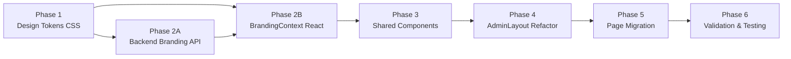

# TAMEED CRM – MASTER COMPONENT DESIGN SYSTEM & ARCHITECTURE

## 1. ROLE & MISSION

Act as a Senior SaaS Design System Architect, Senior Frontend Engineer, and Enterprise UX Engineer.

Your mission is to establish a unified, reusable, scalable component architecture for Tameed CRM.

The application is a multi-tenant automotive CRM SaaS platform serving companies and car dealerships in Saudi Arabia.

You must build a centralized component system where:

1. Every tenant uses the same UI structure.
2. Every tenant can have its own logo and brand colors.
3. Branding is loaded dynamically from the database.
4. Semantic status colors remain globally consistent.
5. All components follow the approved Tameed CRM design language.
6. Components are reusable, configurable, and maintainable.
7. No page should introduce its own independent design rules.

IMPORTANT:
Do not simply create new components without inspecting existing ones. Audit the project first, identify reusable components, consolidate duplicated implementations, and preserve existing functionality.

---

# 2. APPROVED VISUAL DESIGN DIRECTION

Use the approved Tameed CRM dashboard screenshot as the primary visual reference.

The design language must follow:

- Light theme.
- Dark forest-green sidebar.
- Lime-green primary actions.
- Clean white content cards.
- Soft gray application background.
- Subtle borders.
- Minimal shadows.
- Rounded corners.
- Compact enterprise layouts.
- Consistent outline icons.
- Arabic RTL as the primary interface direction.

Avoid:

- Excessive gradients.
- Glassmorphism.
- Neon effects.
- Excessive decorative elements.
- Oversized cards.
- Unnecessary illustrations.
- Too many competing colors.
- Different visual styles between pages.

The UI must prioritize productivity, data readability, and daily CRM operations.

---

# 3. THREE-LAYER DESIGN ARCHITECTURE

Implement the design system using three independent layers.

## Layer A – Shared Design System

This layer controls the structure and appearance of the application.

It includes:

- Layout.
- Spacing.
- Typography.
- Component dimensions.
- Borders.
- Radius.
- Shadows.
- Icons.
- Interaction states.
- Responsive behavior.
- RTL/LTR behavior.

This layer must be identical across all tenants.

## Layer B – Tenant Branding Engine

This layer controls the tenant's visual identity.

Each tenant can configure:

- Company logo.
- Company name.
- Primary color.
- Primary hover color.
- Secondary brand color.
- Accent color.
- Optional sidebar branding settings.

All branding information must be stored and retrieved from the database.

The application must load the authenticated tenant's branding dynamically.

## Layer C – Semantic Status System

This layer controls system-wide operational states.

Semantic colors must NEVER be overridden by tenant branding.

Examples:

- Success.
- Warning.
- Danger.
- Information.
- Neutral.
- Pending.
- Delivered.
- Rejected.
- Cancelled.

These colors must remain consistent across every tenant.

---

# 4. TENANT BRANDING ENGINE

Create a centralized tenant branding configuration.

Suggested data structure:

TenantBranding {
  tenant_id,
  company_name,
  company_logo,
  primary_color,
  primary_hover_color,
  secondary_color,
  accent_color,
  is_active
}

Adapt the actual database implementation to the existing project architecture.

## Branding Loading Rules

1. Identify the authenticated tenant.
2. Retrieve its branding configuration.
3. Validate the returned color values.
4. Load the company logo.
5. Generate CSS custom properties.
6. Apply branding to shared components.
7. Cache branding appropriately.
8. Update the theme when the tenant changes.
9. Provide safe default branding if configuration is unavailable.

Never use hardcoded tenant branding in shared components.

Never allow one tenant's branding to affect another tenant.

Ensure tenant isolation at the backend and database levels.

## CSS Theme Variables

Use centralized design tokens.

Example:

:root {
  /* Tenant Branding */
  --tenant-primary: #092C29;
  --tenant-primary-hover: #071F1D;
  --tenant-secondary: #D5F52B;
  --tenant-accent: #D5F52B;

  /* Application Structure */
  --app-background: #F4F6F8;
  --surface-primary: #FFFFFF;
  --surface-secondary: #F8F9FA;

  /* Borders */
  --border-default: #E7EAEE;
  --border-strong: #D8DDE3;

  /* Typography */
  --text-primary: #20252B;
  --text-secondary: #727D89;
  --text-muted: #9AA3AD;

  /* Semantic Colors – Immutable */
  --status-success: #16A36A;
  --status-warning: #E9A23B;
  --status-danger: #DC5555;
  --status-info: #3986D9;
  --status-neutral: #8A929B;
}

Important:
Tenant branding variables and semantic variables must be separated.

Do not use --tenant-primary for order status colors.

---

# 5. SHARED COMPONENT RULES

Every shared component must follow these rules:

1. Reusable across all modules.
2. Independent of tenant-specific branding values.
3. Receive configuration through props or centralized context.
4. Use design tokens instead of hardcoded colors.
5. Support Arabic RTL and English LTR.
6. Support responsive layouts.
7. Include loading, empty, disabled, and error states where applicable.
8. Maintain consistent typography.
9. Use consistent spacing.
10. Preserve accessibility and keyboard interactions.

Avoid creating duplicate components for different tenants.

Avoid creating page-specific versions of standard UI elements unless there is a genuine functional requirement.

---

# 6. COMPONENT LIBRARY SPECIFICATION

Create or consolidate the following components.

## A. Application Layout Components

- AppLayout
- Sidebar
- SidebarHeader
- SidebarNavigation
- SidebarNavigationItem
- SidebarGroup
- SidebarFooter
- TenantLogo
- PoweredByBrand
- TopHeader
- GlobalSearch
- NotificationMenu
- UserProfileMenu
- LanguageSwitcher
- Breadcrumbs
- PageContainer
- PageHeader

### Sidebar Rules

The sidebar must:

- Use the tenant's configured sidebar branding.
- Display the tenant logo at the top.
- Display company name when appropriate.
- Show navigation groups consistently.
- Use the same icon system.
- Highlight the active route using tenant primary color.
- Display Tameed CRM branding subtly at the bottom.

The Tameed logo must never replace the tenant logo.

## B. Button Components

Create:

- Button
- IconButton
- ButtonGroup
- SplitButton

Supported variants:

- Primary.
- Secondary.
- Outline.
- Ghost.
- Danger.
- Link.

Supported sizes:

- Small.
- Medium.
- Large.

Rules:

- Primary buttons use tenant primary color.
- Hover states use tenant primary hover.
- Danger buttons use semantic danger.
- Disabled states use neutral styling.
- Use consistent height and radius.
- Do not create custom button styles inside individual pages.

## C. Form Components

Create:

- Input
- Textarea
- Select
- SearchInput
- DatePicker
- DateRangePicker
- Checkbox
- Radio
- Switch
- FormField
- FormLabel
- FormError
- InputGroup

Rules:

- Consistent heights.
- Clear focus states.
- Proper RTL alignment.
- Consistent validation messages.
- Accessible labels.
- Proper disabled and error states.

## D. Data Display Components

Create:

- Card
- StatCard
- DataTable
- TableHeader
- TableRow
- TableCell
- TableActions
- Pagination
- EmptyState
- LoadingState
- Skeleton
- Tooltip
- Avatar
- AvatarGroup

### DataTable Rules

The DataTable must support:

- RTL and LTR.
- Sorting.
- Pagination.
- Row selection.
- Bulk actions.
- Custom columns.
- Loading states.
- Empty states.
- Responsive behavior.
- Column visibility where appropriate.

Avoid implementing a separate table system for every module.

## E. Status Components

Create:

- StatusBadge
- StatusIndicator
- StatusTimeline
- StatusLegend
- StatusSummary

Use semantic tokens only.

Status color mapping:

SUCCESS:
- Delivered.
- Approved.
- Completed.
- Active where appropriate.

WARNING:
- Pending.
- Waiting.
- Requires attention.

DANGER:
- Rejected.
- Failed.
- Cancelled when the business state requires a destructive indication.

INFO:
- New.
- In Progress.
- Under Review.

NEUTRAL:
- Draft.
- Archived.
- Inactive.

Important:
Actual status-to-color mappings must follow the existing business workflow and must not be changed without inspecting the backend status definitions.

## F. Feedback Components

Create:

- Modal
- Drawer
- ConfirmationDialog
- DropdownMenu
- Toast
- Alert
- ProgressBar
- Tabs
- Accordion

Rules:

- Consistent overlay behavior.
- Consistent z-index architecture.
- Accessible focus management.
- Proper keyboard navigation.
- Responsive sizing.
- Consistent animation timing.

## G. CRM-Specific Components

Create reusable business components:

- CustomerCard
- VehicleCard
- OrderCard
- OrderSummary
- OrderStatusBadge
- OrderTimeline
- SalesRepresentativeCard
- TaskCard
- FollowUpCard
- ActivityLog
- SalesChart
- OrdersChart
- KanbanBoard
- KanbanColumn
- KanbanItem
- CustomerInformationPanel
- VehicleInformationPanel

These components must reuse the shared UI components wherever possible.

---

# 7. DESIGN TOKENS AND SPACING SYSTEM

Create a centralized token system.

## Spacing

Use a consistent 4px-based scale:

4px
8px
12px
16px
20px
24px
32px
40px
48px

## Border Radius

- Small: 6px.
- Medium: 8px.
- Large: 12px.
- Extra Large: 16px.

Use consistent radii.

Avoid excessive rounded-pill styling.

## Shadows

Use subtle shadows only.

Most cards should rely on a light border rather than a strong shadow.

## Typography

Arabic:
IBM Plex Sans Arabic or Tajawal.

English:
Inter.

Maintain consistent line heights and font weights.

---

# 8. ICON SYSTEM

Use one icon library across the entire platform.

Preferred:
Lucide Icons.

Rules:

- Outline style.
- Consistent stroke width.
- Consistent icon sizing.
- Consistent alignment.
- No emoji as interface icons.
- No random mixing of icon libraries.

Suggested sizes:

- Small: 14px.
- Medium: 16px.
- Large: 20px.
- Navigation: 18px.

---

# 9. COMPONENT ARCHITECTURE AND FOLDER STRUCTURE

Adapt the following structure to the existing framework.

Example:

components/
  layout/
    AppLayout
    Sidebar
    Header
    PageHeader

  ui/
    Button
    Input
    Select
    Card
    Modal
    Tabs
    Tooltip
    Avatar

  data-display/
    DataTable
    Pagination
    StatCard
    EmptyState
    Skeleton

  feedback/
    Alert
    Toast
    StatusBadge
    ConfirmationDialog

  crm/
    orders/
    customers/
    vehicles/
    tasks/
    sales/
    analytics/

  branding/
    TenantLogo
    TenantThemeProvider
    PoweredByBrand
    ThemeTokens

styles/
  tokens
  themes
  semantic-colors
  typography
  layout

Do not blindly create this structure if the project already has a suitable architecture. Refactor carefully and follow existing conventions.

---

# 10. COMPONENT GOVERNANCE RULES

These rules are mandatory.

1. No hardcoded brand colors inside shared components.
2. No duplicated button implementations.
3. No duplicated form field implementations.
4. No arbitrary border-radius values.
5. No arbitrary spacing values when design tokens exist.
6. No inconsistent icon styles.
7. No tenant-specific conditional styling scattered across pages.
8. No tenant branding in semantic status tokens.
9. No independent page-level design systems.
10. No breaking changes to existing workflows.

Every new component must use the shared system.

Every existing component must be evaluated before replacement.

---

# 11. VALIDATION AND TESTING

Create a component validation checklist.

Test the system using at least three simulated tenant themes:

Tenant A:
- Dark green.
- Lime accent.
- White logo.

Tenant B:
- Navy blue.
- Gold accent.
- Different company logo.

Tenant C:
- Burgundy.
- Light neutral accent.
- Different company logo.

Verify:

- Logos update correctly.
- Primary actions update correctly.
- Active navigation updates correctly.
- Components maintain identical dimensions.
- Layout does not change between tenants.
- Semantic status colors remain unchanged.
- Arabic and English layouts work correctly.
- No tenant data leaks into another tenant's theme.
- No visual regressions occur.

Do not introduce simulated tenant data into production.

---

# 12. FINAL ACCEPTANCE CRITERIA

The implementation is complete only when:

- A centralized shared component library exists.
- Tenant branding is database-driven.
- Tenant theme switching works correctly.
- Semantic status colors are immutable by tenant branding.
- All major pages use shared components.
- Existing functionality remains intact.
- RTL/LTR works consistently.
- Responsive layouts work correctly.
- The approved Tameed CRM visual identity is preserved.
- Duplicate styles and components are reduced.
- The system is documented.

## EXECUTION INSTRUCTIONS

PHASE 1:
Audit the existing repository and identify the current component architecture.

PHASE 2:
Document the component inventory, duplicated components, and design inconsistencies.

PHASE 3:
Build the centralized design tokens and tenant branding engine.

PHASE 4:
Build or consolidate shared components.

PHASE 5:
Migrate the dashboard, orders, workflow tracking, customers, vehicles, and remaining modules.

PHASE 6:
Run regression tests and verify multiple tenant themes.

Do not stop after producing a plan.

After presenting the audit findings and implementation plan, proceed with implementation in controlled phases.

Preserve all existing business logic, APIs, permissions, data structures, and workflows unless a change is explicitly required and approved.


# خطة تطبيق هوية Tameed CRM عبر جميع الكومبوننتس

> [!IMPORTANT]
> هذه خطة تنفيذية مرحلية كاملة بناءً على أوديت للمشروع الحالي. كل مرحلة قابلة للتنفيذ المستقل.

---

## 🔍 نتائج الأوديت الأولي

### الوضع الحالي

| الجانب | الوضع |
|---|---|
| **Stack** | React 19 + TailwindCSS v4 + Lucide Icons ✅ |
| **Layout الأدمن** | `AdminLayout.tsx` — Sidebar + Header مكتمل |
| **UI Components** | `Button`, `Badge`, `Card`, `Input` داخل `/admin/components/ui/` |
| **الألوان الحالية** | `indigo-600` hardcoded في كل مكان ❌ |
| **الواجهة العامة** | `header.tsx` + `button.tsx` بدون design tokens |
| **CSS Variables** | `app.css` فارغ تقريباً — لا tokens ❌ |
| **Multi-tenant** | لا يوجد نظام branding — `active_company_id` موجود في User model |
| **Duplication** | Button مكرر مرتين (admin + public) ❌ |
| **Typography** | `Instrument Sans` فقط — لا Arabic font محدد ❌ |

### المشاكل المكتشفة

1. **Hardcoded Colors**: `indigo-600` في `Button`, `Badge`, `AdminLayout`, `Input`, `AuthContext`
2. **Button مكرر**: `/admin/components/ui/Button.tsx` و `/components/button.tsx`
3. **Badge مكرر**: `/admin/components/ui/Badge.tsx` و `/components/Badge.tsx`
4. **لا CSS Design Tokens**: الألوان مكتوبة مباشرة في className
5. **لا Branding Context**: لا يوجد `TenantBrandingContext`
6. **لا Semantic Status System**: `getStatusBadgeVariant()` مكررة في كل page
7. **لا Typography System**: الخط العربي غير محدد
8. **Company Model غير موجود**: `active_company_id` في User بدون Model مقابل

---

## 🏗 المعمارية المستهدفة

```
resources/react/
├── admin/
│   ├── components/
│   │   └── ui/              ← الكومبوننتس الموجودة (ستُرفَّق بالنظام الجديد)
│   ├── context/
│   │   ├── AuthContext.tsx   ← موجود
│   │   └── BrandingContext.tsx  ← جديد ✨
│   ├── layouts/
│   │   └── AdminLayout.tsx   ← يُعاد تشكيله
│   └── pages/               ← تُهاجَر لاستخدام tokens
│
├── shared/                  ← مجلد مشترك جديد ✨
│   ├── components/
│   │   ├── ui/
│   │   │   ├── Button.tsx
│   │   │   ├── Badge.tsx
│   │   │   ├── Card.tsx
│   │   │   ├── Input.tsx
│   │   │   ├── Select.tsx
│   │   │   ├── StatusBadge.tsx
│   │   │   ├── DataTable.tsx
│   │   │   ├── Pagination.tsx
│   │   │   ├── EmptyState.tsx
│   │   │   ├── Skeleton.tsx
│   │   │   └── Modal.tsx
│   │   └── branding/
│   │       ├── TenantThemeProvider.tsx
│   │       └── TenantLogo.tsx
│   └── tokens/
│       └── design-tokens.css
│
└── components/              ← الواجهة العامة (تُرفَّد بالتوكنز)
```

---

## 📋 الخطة التنفيذية — 6 مراحل

---

## المرحلة 1: Design Tokens & CSS Foundation
**الملفات المتأثرة**: `resources/css/app.css`

### ما يُبنى

**`resources/react/shared/tokens/design-tokens.css`** — ملف CSS Variables مركزي:

```css
/* ==============================
   TAMEED CRM — DESIGN TOKENS
   ============================== */

@layer base {
  :root {
    /* ── Tenant Branding (overridable per tenant) ── */
    --tenant-primary:       #092C29;
    --tenant-primary-hover: #071F1D;
    --tenant-secondary:     #D5F52B;
    --tenant-accent:        #D5F52B;
    --tenant-sidebar-bg:    #0D3B37;
    --tenant-logo-url:      "";

    /* ── App Structure (global — never override) ── */
    --app-bg:            #F4F6F8;
    --surface-primary:   #FFFFFF;
    --surface-secondary: #F8F9FA;

    /* ── Borders ── */
    --border-default: #E7EAEE;
    --border-strong:  #D8DDE3;

    /* ── Typography ── */
    --text-primary:   #20252B;
    --text-secondary: #727D89;
    --text-muted:     #9AA3AD;

    /* ── Semantic Status (IMMUTABLE — never override) ── */
    --status-success: #16A36A;
    --status-warning: #E9A23B;
    --status-danger:  #DC5555;
    --status-info:    #3986D9;
    --status-neutral: #8A929B;
    --status-pending: #E9A23B;

    /* ── Spacing Scale (4px base) ── */
    --space-1: 4px;
    --space-2: 8px;
    --space-3: 12px;
    --space-4: 16px;
    --space-5: 20px;
    --space-6: 24px;
    --space-8: 32px;
    --space-10: 40px;
    --space-12: 48px;

    /* ── Border Radius ── */
    --radius-sm: 6px;
    --radius-md: 8px;
    --radius-lg: 12px;
    --radius-xl: 16px;
  }
}
```

**تحديث `app.css`**: إضافة import للتوكنز + الخطوط:
```css
@import 'tailwindcss';
@import './design-tokens.css';

@import url('https://fonts.googleapis.com/css2?family=IBM+Plex+Sans+Arabic:wght@300;400;500;600;700&family=Inter:wght@300;400;500;600;700&display=swap');

@theme {
  --font-sans:   'Inter', ui-sans-serif, system-ui, sans-serif;
  --font-arabic: 'IBM Plex Sans Arabic', 'Inter', sans-serif;
}

/* RTL Arabic Typography */
[dir="rtl"] body,
[lang="ar"] body {
  font-family: var(--font-arabic);
}

/* App Background */
body { background-color: var(--app-bg); }
```

> [!NOTE]
> `design-tokens.css` يُودَع داخل `resources/css/` ليُستخدم من الـ Vite pipeline.

---

## المرحلة 2: Tenant Branding Engine
**الملفات المتأثرة**: Backend (PHP) + React Context

### 2A — Backend: Company Branding Model

> [!IMPORTANT]
> `active_company_id` موجود في User model — نحتاج Company model + branding API endpoint.

**الخطوات**:

1. **Migration**: إنشاء جدول `companies` + `company_brandings`
   ```
   php artisan make:model Company -m
   php artisan make:model CompanyBranding -m
   ```

   جدول `companies`:
   - `id`, `name`, `slug`, `is_active`, `timestamps`

   جدول `company_brandings`:
   - `id`, `company_id` (FK), `logo_path`, `primary_color`, `primary_hover_color`, `secondary_color`, `accent_color`, `sidebar_bg_color`, `is_active`, `timestamps`

2. **API Endpoint**: `/api/admin/branding` — يُعيد branding الـ tenant الحالي
   ```
   php artisan make:controller Api/Admin/BrandingController
   ```
   
   Response:
   ```json
   {
     "primary_color": "#092C29",
     "primary_hover_color": "#071F1D",
     "secondary_color": "#D5F52B",
     "accent_color": "#D5F52B",
     "sidebar_bg": "#0D3B37",
     "logo_url": "...",
     "company_name": "..."
   }
   ```

3. **Validation**: ألوان صحيحة HEX فقط + fallback للقيم الافتراضية

### 2B — Frontend: BrandingContext

**`resources/react/admin/context/BrandingContext.tsx`**:

```tsx
// Context يجلب الـ branding من API ويطبقها كـ CSS variables على <html>
// يستخدم useQuery لجلب البيانات مرة واحدة
// يطبق: document.documentElement.style.setProperty('--tenant-primary', color)
// يوفر: useBranding() hook
// Fallback: القيم الافتراضية في design-tokens.css
```

**التكامل**: إضافة `<BrandingProvider>` داخل `AdminLayout.tsx` فوق `<Outlet>`

---

## المرحلة 3: Shared Component Library
**الملفات المتأثرة**: `resources/react/shared/components/ui/`

### 3A — ترحيل الكومبوننتس الموجودة

| الكومبوننت | الحالة | الإجراء |
|---|---|---|
| `/admin/components/ui/Button.tsx` | يستخدم `indigo-600` hardcoded | ✏️ تعديل لـ tokens |
| `/admin/components/ui/Badge.tsx` | `indigo` hardcoded | ✏️ تعديل |
| `/admin/components/ui/Card.tsx` | جيد نسبياً | ✏️ تعديل border/shadow |
| `/admin/components/ui/Input.tsx` | `indigo` focus hardcoded | ✏️ تعديل |
| `/components/button.tsx` | يستخدم `--brand-primary-color` | 🔗 دمج مع Shared |
| `/components/Badge.tsx` | مكرر | 🗑 حذف والاستبدال |

### 3B — Button المُحدَّث (بدون indigo)

```tsx
const variants = {
  primary: 'bg-[var(--tenant-primary)] hover:bg-[var(--tenant-primary-hover)] text-white',
  secondary: 'bg-[var(--surface-secondary)] hover:bg-[var(--border-default)] text-[var(--text-primary)] border border-[var(--border-default)]',
  outline: 'border border-[var(--border-default)] bg-white hover:bg-[var(--surface-secondary)] text-[var(--text-primary)]',
  ghost: 'hover:bg-[var(--surface-secondary)] text-[var(--text-secondary)]',
  danger: 'bg-[var(--status-danger)] hover:opacity-90 text-white',
  link: 'underline text-[var(--tenant-primary)] hover:opacity-80',
};
```

### 3C — StatusBadge الجديد (Semantic)

كومبوننت منفصل عن Badge يستخدم `--status-*` فقط:

```tsx
// StatusBadge.tsx — يُعطى status string ويعيد اللون الصحيح
// mappings: 'sold' | 'completed' | 'done' → success
//           'pending' | 'bank_review' → warning
//           'rejected' | 'lost_*' → danger
//           'in_progress' | 'new' → info
//           'draft' | 'archived' → neutral
// لا يستخدم tenant colors أبداً
```

### 3D — الكومبوننتس الجديدة المطلوبة

**كومبوننتس ذات أولوية عالية** (تُبنى أولاً):

1. **`DataTable.tsx`**: يستبدل الجداول المكررة في BookingsPage, LeadsPage, etc.
   - Columns config, sorting, pagination props
   - loading/empty states مدمجة

2. **`EmptyState.tsx`**: نمط موحد لحالات "لا توجد بيانات"

3. **`Skeleton.tsx`**: loading skeletons

4. **`Modal.tsx`**: يستبدل modals المكررة في الصفحات

5. **`Pagination.tsx`**: يستبدل pagination المكررة

**كومبوننتس ذات أولوية متوسطة**:

6. `Select.tsx`, `Textarea.tsx`, `SearchInput.tsx`
7. `StatCard.tsx` — لصفحة Dashboard (يستبدل الـ KPI cards المكررة)
8. `TenantLogo.tsx` — يعرض لوغو الـ tenant أو placeholder

---

## المرحلة 4: AdminLayout Refactor
**الملفات المتأثرة**: `AdminLayout.tsx`

### التغييرات على AdminLayout

1. **إضافة BrandingProvider** داخل Layout
2. **Sidebar**: تغيير `bg-slate-900` → `bg-[var(--tenant-sidebar-bg)]`
3. **Active NavLink**: تغيير `bg-indigo-600` → `bg-[var(--tenant-primary)]`
4. **Brand Section**: إضافة `<TenantLogo>` بدلاً من الـ "S" placeholder
5. **Notification dot**: تغيير `bg-indigo-600` → `bg-[var(--tenant-primary)]`
6. **Company name**: يُجلب من BrandingContext

```tsx
// قبل:
className="bg-indigo-600 text-white"

// بعد:
className="bg-[var(--tenant-primary)] text-white"
// أو باستخدام style prop:
style={{ backgroundColor: 'var(--tenant-primary)' }}
```

---

## المرحلة 5: Page Migration
**الملفات المتأثرة**: جميع صفحات `/admin/pages/`

### أولوية الترحيل

| الصفحة | المشاكل الحالية | الأولوية |
|---|---|---|
| `DashboardPage.tsx` | KPI cards مع ألوان hardcoded (indigo/amber/emerald/rose) | 🔴 عالية |
| `BookingsPage.tsx` | `getStatusBadgeVariant()` محلية، جدول يدوي | 🔴 عالية |
| `LeadsPage.tsx` | يُرجَّح وجود نفس المشاكل | 🔴 عالية |
| `TasksPage.tsx` | نفس النمط | 🟡 متوسطة |
| `EmployeesPage.tsx` | نفس النمط | 🟡 متوسطة |
| `CarsPage.tsx` | نفس النمط | 🟡 متوسطة |
| `ReportsPage.tsx` | — | 🟢 منخفضة |
| `SettingsPage.tsx` | — | 🟢 منخفضة |

### نمط الترحيل لكل صفحة

**قبل (DashboardPage)**:
```tsx
color: 'text-indigo-600 bg-indigo-50 border-indigo-200/60'
color: 'text-amber-600 bg-amber-50 border-amber-200/60'
// ... ألوان مختلفة لكل KPI
```

**بعد**:
```tsx
// استخدام StatCard component:
<StatCard
  label="إجمالي الحجوزات"
  value={bStats.total}
  icon={CalendarCheck}
  trend="up"
/>
// StatCard يستخدم --tenant-primary للأيقونة، --text-primary للأرقام
```

**قبل (BookingsPage)**:
```tsx
const getStatusBadgeVariant = (status: string) => { ... } // في كل page
```

**بعد**:
```tsx
import { StatusBadge } from '@/shared/components/ui/StatusBadge';
<StatusBadge status={booking.status} />
// StatusBadge يتعامل مع كل mappings مركزياً
```

---

## المرحلة 6: Public Frontend & Testing
**الملفات المتأثرة**: `/resources/react/components/`

### 6A — ترحيل الواجهة العامة

الواجهة العامة (`/resources/react/`) تستخدم `--brand-primary-color` بالفعل في `button.tsx` — هذا قريب من المطلوب. التحديثات:

1. **`header.tsx`**: استبدال الألوان الـ hardcoded (`#16254F`, `#667085`) بـ CSS variables
2. **`button.tsx`**: توحيد المتغير مع النظام الجديد (`--tenant-primary`)
3. **إضافة font Arabic** للصفحات العامة

### 6B — Validation Checklist

```
☐ Tenant A (Dark Green + Lime):  --tenant-primary: #092C29  --tenant-secondary: #D5F52B
☐ Tenant B (Navy + Gold):        --tenant-primary: #1A3A5C  --tenant-secondary: #D4A017
☐ Tenant C (Burgundy + Neutral): --tenant-primary: #6D1A36  --tenant-secondary: #9AA3AD

لكل tenant تحقق من:
☐ Logo يظهر صحيحاً في Sidebar
☐ Primary buttons تأخذ tenant color
☐ Active nav link تأخذ tenant color
☐ Status badges تبقى ثابتة (لا تتغير بالتبديل)
☐ Layout dimensions لا تتغير
☐ RTL يعمل صحيحاً
☐ لا tenant data leak بين tenants
```

---

## 📂 ملخص الملفات المطلوب إنشاؤها

```
✨ جديد:
resources/css/design-tokens.css
resources/react/shared/components/ui/Button.tsx
resources/react/shared/components/ui/Badge.tsx
resources/react/shared/components/ui/StatusBadge.tsx
resources/react/shared/components/ui/Card.tsx
resources/react/shared/components/ui/Input.tsx
resources/react/shared/components/ui/DataTable.tsx
resources/react/shared/components/ui/Pagination.tsx
resources/react/shared/components/ui/EmptyState.tsx
resources/react/shared/components/ui/Skeleton.tsx
resources/react/shared/components/ui/Modal.tsx
resources/react/shared/components/ui/StatCard.tsx
resources/react/shared/components/branding/TenantThemeProvider.tsx
resources/react/shared/components/branding/TenantLogo.tsx
resources/react/admin/context/BrandingContext.tsx
app/Models/Company.php
app/Models/CompanyBranding.php
app/Http/Controllers/Api/Admin/BrandingController.php
database/migrations/xxxx_create_companies_table.php
database/migrations/xxxx_create_company_brandings_table.php

✏️ تعديل:
resources/css/app.css
resources/react/admin/layouts/AdminLayout.tsx
resources/react/admin/components/ui/Button.tsx  → يصبح wrapper أو يُزال
resources/react/admin/components/ui/Badge.tsx   → يصبح wrapper أو يُزال
resources/react/admin/components/ui/Input.tsx   → tokens
resources/react/admin/pages/DashboardPage.tsx   → StatCard + tokens
resources/react/admin/pages/BookingsPage.tsx    → StatusBadge + DataTable
resources/react/admin/pages/LeadsPage.tsx       → نفس النمط
resources/react/components/button.tsx           → توحيد مع shared
resources/react/components/header.tsx           → tokens
```

---

## ⚡ ترتيب التنفيذ المقترح



> [!TIP]
> ابدأ بـ **Phase 1** (CSS Tokens) — هي الأسرع وتُمكّن كل شيء بعدها. ثم **Phase 3** (Shared Components) يمكن البدء به موازياً مع Phase 2.

> [!WARNING]
> لا تحذف `/admin/components/ui/Button.tsx` وما شابهه مباشرةً — اجعلها تعيد تصدير الكومبوننت من `shared` حتى لا تنكسر الـ imports الموجودة:
> ```tsx
> // admin/components/ui/Button.tsx
> export { Button } from '@/shared/components/ui/Button';
> ```
